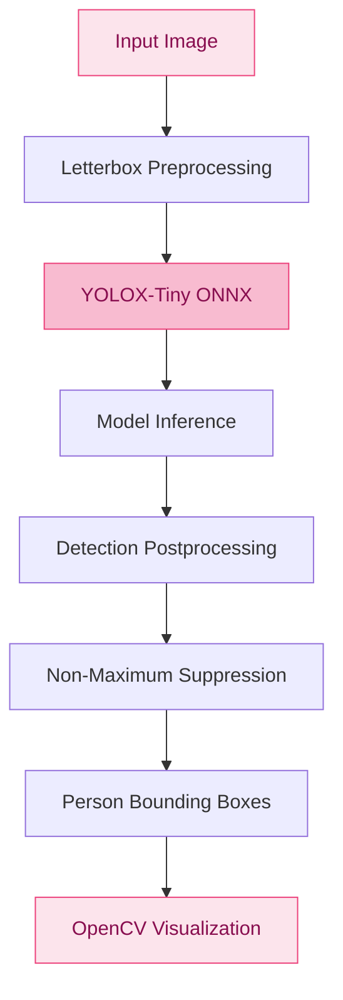

 <div align="center">


[](https://python.org)
[](https://onnxruntime.ai/)
[](https://github.com/kyutakou/NANAMI)
[](./docs/LICENSING.md)

**A classroom computer-vision research project with a focus on privacy, observation, and responsible technology.**

[Overview](#-overview) · [Features](#-current-features) · [Architecture](#-architecture) · [Setup](#-getting-started) · [Ethics](#-privacy-and-ethics)

</div>

---

## ୨୧ Overview

NANAMI is a student-led research project exploring how computer vision can assist in observing classroom environments.

The project currently focuses on person detection using YOLOX-Tiny and ONNX Runtime. Future development may explore anonymous multi-person tracking, pose estimation, and research-oriented event analysis.

The goal is to study what computer vision can observe without attempting to identify who someone is.

**Less identification, more investigation.**

## ♡ Current features

| Feature | Status |
|---|---|
| YOLOX-Tiny person detection | Implemented |
| ONNX Runtime CPU inference | Implemented |
| Image preprocessing and letterboxing | Implemented |
| Non-maximum suppression | Implemented |
| Bounding-box visualization | Implemented |
| Anonymous multi-person tracking | In local development; not yet published |
| Pose estimation | Planned |
| Temporal analysis | Planned |
| Backend and dashboard | Planned |

### Detection pipeline

The publicly available detection implementation uses:

- **YOLOX-Tiny:** detects people in input images.
- **ONNX Runtime:** runs model inference using the CPU execution provider.
- **OpenCV:** handles image preprocessing and visualization.
- **NumPy:** supports numerical operations and detection postprocessing.

The current detector draws green bounding boxes around detected people.

### Preliminary performance

A local test has produced an observed processing speed of approximately **13 FPS**.

This is an early observation, not a standardized benchmark. Performance can vary depending on hardware, image resolution, and model configuration.

## ୨୧ Architecture

The currently published detection pipeline:



Anonymous tracking is being developed separately and is not yet included in the published pipeline.

## ୨୧ Technology stack

| Component | Technology |
|---|---|
| Programming language | Python |
| Object detection | YOLOX-Tiny |
| Model format | ONNX |
| Inference | ONNX Runtime |
| Image processing | OpenCV |
| Numerical computing | NumPy, SciPy |
| Testing | pytest |
| Environment management | Python venv / pip |
| Future frontend | React, Vite, TypeScript |

## ୨୧ Development roadmap

- [x] **Phase 1 — Person Detection**
  - YOLOX-Tiny ONNX integration
  - Detector interface
  - Image preprocessing
  - Detection postprocessing
  - Bounding-box visualization
  - Initial detector tests

- [ ] **Phase 2 — Anonymous Person Tracking**
  - ByteTrack-style tracking implementation
  - Detection-to-track association
  - Multi-frame tracking
  - Track continuity evaluation
  - Multi-person testing

- [ ] **Phase 3 — Detection and Tracking Integration**
  - Pipeline integration
  - Performance evaluation
  - Occlusion and tracking reliability tests

- [ ] **Phase 4 — Pose Estimation**
  - RTMPose integration
  - Keypoint extraction
  - Pose estimation validation

- [ ] **Phase 5 — Research Analysis**
  - Temporal observation
  - Research-based analysis
  - False-positive evaluation
  - Human-verifiable outputs

- [ ] **Phase 6 — Backend and Dashboard**
  - Backend development
  - Dashboard interface
  - Review workflow
  - Results visualization

*Development status reflects the publicly available repository. Features under local development may not yet appear in the source code.*

## ୨୧ Getting started

### Requirements

- Python 3.11 or compatible version
- Git
- A YOLOX-Tiny ONNX model file
- Windows or Linux environment

### 1. Clone the repository

```bash
git clone https://github.com/kyutakou/NANAMI.git
cd NANAMI
```

### 2. Create a virtual environment

```bash
python -m venv .venv
```

Activate it:

**Windows PowerShell**
```powershell
.venv\Scripts\Activate.ps1
```

**Linux**
```bash
source .venv/bin/activate
```

### 3. Install dependencies

```bash
pip install -r backend/requirements.txt
pip install pytest
```

### 4. Add the model file

Place your appropriately sourced YOLOX-Tiny ONNX model at:

```text
models/
└── yolox_tiny/
    └── yolox_tiny.onnx
```

Model weights are not included in this repository. Check the model's source and licensing terms before using or redistributing it.

### 5. Run the detector

```bash
python scripts/try_detector.py path/to/consented_photo.jpg
```

The script runs detection, measures inference time, and saves an annotated image under `data/evidence/`.

### 6. Run tests

```bash
pytest
```

Tests that require the external model file are skipped when the model is unavailable.

## ୨୧ Project structure

```text
NANAMI/
├── backend/
│   ├── app/
│   │   └── modules/
│   │       ├── detection/
│   │       ├── tracking/
│   │       ├── pose/
│   │       └── analysis/
│   ├── tests/
│   └── requirements.txt
├── data/
│   ├── database/
│   └── evidence/
├── docs/
│   └── LICENSING.md
├── frontend/
├── models/
├── scripts/
├── .gitignore
├── pyproject.toml
└── README.md
```

Some directories are placeholders for future development.

## ୨୧ Privacy and ethics

NANAMI is designed with privacy as a central research consideration.

The project aims to avoid:

- Facial recognition.
- Real-world identity identification.
- Personal identity databases.
- Automated disciplinary decisions.
- Unnecessary footage collection.

Responsible deployment would also require:

- Appropriate consent and institutional approval.
- Restricted access to footage and research outputs.
- Defined data-retention periods.
- Data minimization.
- Evaluation of false detections and tracking errors.
- Human verification before interpreting system observations.

**Detection is not identification, and observation is not proof.**

NANAMI is an experimental research prototype. It must not be used as an autonomous cheating detector or as the sole basis for disciplinary action.

## ୨୧ Limitations

The project is still under development. Its current limitations include:

- Detection accuracy depends on image quality and environmental conditions.
- Occlusion and overlapping people can affect detection.
- Tracking performance has not yet been fully evaluated in the public repository.
- The reported FPS is preliminary.
- Pose estimation and behavioral analysis are not implemented.
- No production-ready backend or dashboard is currently available.

## ୨୧ Licensing

The repository's licensing status is still being reviewed.

See [`docs/LICENSING.md`](docs/LICENSING.md) for the component licensing register and outstanding verification tasks.

Do not assume that the repository's code license automatically covers pretrained model weights or training datasets.

---

<div align="center">

**Made with curiosity, code, and a little bit of pink.**

*Keep your eyes on the pixels, not the people.*

</div>
