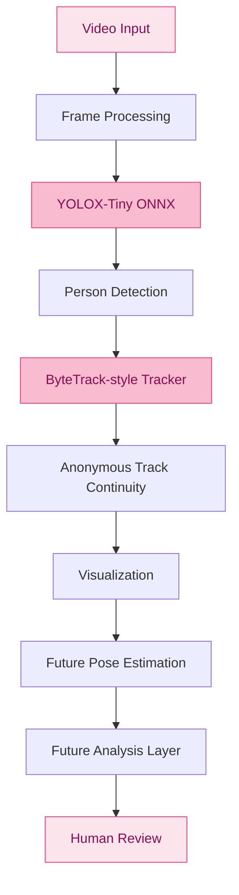

 
<div align="center">


<br/>

[](https://python.org)
[](https://onnxruntime.ai/)
[](https://github.com/kyutakou/NANAMI)
[](https://github.com/kyutakou/NANAMI)

<br/>

**classroom computer-vision that looks, but doesn't know you.**

*A local-first, privacy-conscious classroom computer vision research project.*

[Overview](#-overview) · [Architecture](#-architecture) · [Progress](#-development-progress) · [Setup](#-getting-started)

</div>

---

## ୨୧ Overview

NANAMI is a classroom computer-vision research project designed to detect people, track movement, and eventually assist human reviewers in examining potentially relevant classroom events.

It uses local inference and anonymous tracking rather than facial recognition or personal identity identification.

### ♡ Design philosophy

- **Privacy first.** No facial recognition or identity inference.
- **Local-first.** Processing is designed to happen on the local machine.
- **Human-centered.** Automated observations are never treated as proof of misconduct.
- **Transparent.** Limitations and false detections must be acknowledged.
- **Research-driven.** Every component should be tested and evaluated before integration.

## ୨୧ What NANAMI can do

| Feature | Status |
|---|---|
| YOLOX-Tiny person detection | Working |
| ONNX CPU inference | Working |
| ByteTrack-style tracking | Working |
| Green bounding-box visualization | Working |
| RTMPose-t pose estimation | Planned |
| Behavioral analysis | Planned |
| Backend | Planned |
| Dashboard | Planned |

### Current detection and tracking

NANAMI currently combines:

- **YOLOX-Tiny ONNX** for person detection.
- **ByteTrack-style tracking** using a custom implementation.
- **OpenCV** for image processing and visualization.

Current observed performance:

| Metric | Result |
|---|---|
| Processing speed | ~13 FPS |
| Detection visualization | Green bounding boxes |
| Person identification | Not implemented |
| Inference | CPU-based |

*Performance is preliminary and may vary depending on hardware, input resolution, and the number of people in a frame.*

## ୨୧ Architecture



## ୨୧ Tech stack

| Layer | Technology |
|---|---|
| Primary language | Python 3.11 |
| Environment | uv |
| Detection | YOLOX-Tiny ONNX |
| Tracking | Custom ByteTrack-style implementation |
| Inference | ONNX Runtime (CPU) |
| Image processing | OpenCV |
| Numerical computing | NumPy, SciPy |
| Testing | pytest |
| Future pose estimation | RTMPose-t ONNX |
| Frontend | Vite, React, TypeScript |
| Development OS | Windows 10 |

## ୨୧ Development progress

<details open>
<summary><b>Phase 1 — Person Detection</b> ♡ COMPLETE</summary>

- YOLOX-Tiny ONNX integration.
- Detector interface.
- Person detection pipeline.
- Initial automated detector tests.
- Bounding-box visualization.

</details>

<details open>
<summary><b>Phase 2 — Person Tracking</b> ♡ WORKING</summary>

- Custom ByteTrack-style tracker.
- Detection-to-track association.
- Multiple-frame tracking pipeline.
- Green bounding-box visualization.
- Initial tracking tests and debugging.

</details>

<details open>
<summary><b>Phase 3 — Integration and Testing</b> ♡ WORKING</summary>

- Detection and tracking pipeline tested together.
- Initial performance testing.
- Approximately 13 FPS observed.
- Further reliability and edge-case testing remains necessary.

</details>

<details>
<summary><b>Phase 4 — Pose Estimation</b> ♡ PLANNED</summary>

- RTMPose-t ONNX integration.
- Keypoint extraction.
- Pose estimation validation.

</details>

<details>
<summary><b>Phase 5 — Analysis Layer</b> ♡ PLANNED</summary>

- Temporal observation.
- Research-based analysis.
- False-positive evaluation.
- Human-verifiable outputs.

</details>

<details>
<summary><b>Phase 6 — Backend and Dashboard</b> ♡ PLANNED</summary>

- Backend development.
- Dashboard interface.
- Review workflow.
- Results visualization.

</details>

## ୨୧ Getting started

### Requirements

- Python 3.11
- uv
- Git
- Windows development environment

### Installation

```bash
# Clone the repository
git clone https://github.com/kyutakou/NANAMI.git

# Enter the project
cd NANAMI

# Create virtual environment
uv venv .venv

# Activate environment (Windows Git Bash)
source .venv/Scripts/activate

# Or Windows PowerShell
.venv\Scripts\Activate.ps1

# Install dependencies
uv pip install -e ".[dev]"
```

### Run detector test

```bash
python scripts/try_detector.py --image path/to/consented_photo.jpg
```

### Run tests

```bash
pytest
```

## ୨୧ Privacy and ethical considerations

NANAMI is designed around the principle that observing an event is not the same as knowing what happened.

The project deliberately avoids:

- Facial recognition.
- Real-world identity identification.
- Personal identity databases.
- Automated disciplinary decisions.
- Default cloud-based footage uploads.

Additional safeguards required for research deployment include:

- Appropriate consent and institutional approval.
- Restricted access to footage and results.
- Data minimization and defined retention periods.
- Testing for false detections and tracking errors.
- Human verification before interpreting any observation.

NANAMI must not be used as an autonomous cheating detector or as the sole basis for disciplinary action.

## ୨୧ Limitations

NANAMI is an experimental research prototype.

Its performance and reliability may be affected by:

- Occlusion and overlapping people.
- Lighting conditions.
- Camera placement and viewing angle.
- Detection confidence thresholds.
- Tracking interruptions and ID switches.
- Hardware limitations and processing speed.

A detection or tracking result does not establish intent or misconduct.

## ୨୧ Repository structure

```text
NANAMI/
├── scripts/
│   └── try_detector.py
├── README.md
├── pyproject.toml
└── ...
```

*The repository structure will expand as additional modules are implemented.*

## ୨୧ Contributing and research

NANAMI is being developed as a student research project.

Suggestions, technical feedback, and discussions about computer vision, model performance, and responsible classroom technology are welcome.

Please avoid submitting private classroom footage, identifiable student information, or sensitive personal data.

---

<div align="center">


**NANAMI** ♡

*Seeing patterns. Preserving privacy.*

Made with curiosity, Python, and a little bit of pink.

<sub>© NANAMI Research Project · kyutakou</sub>

</div>
